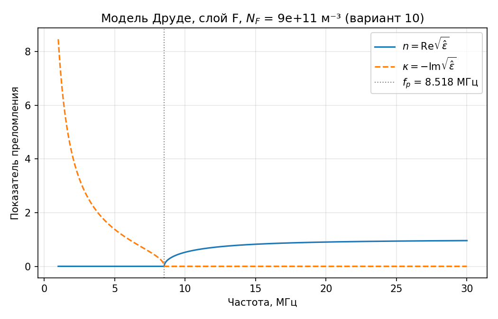
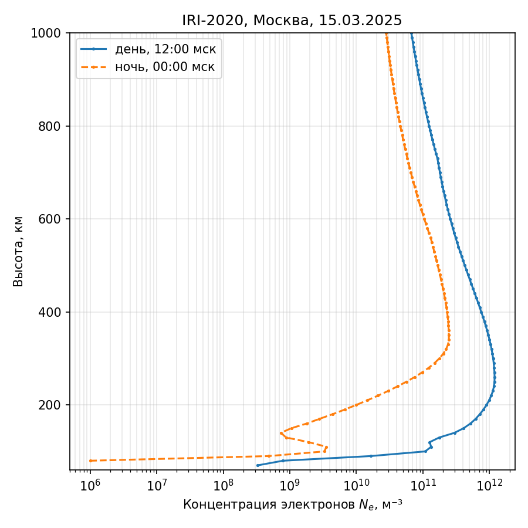
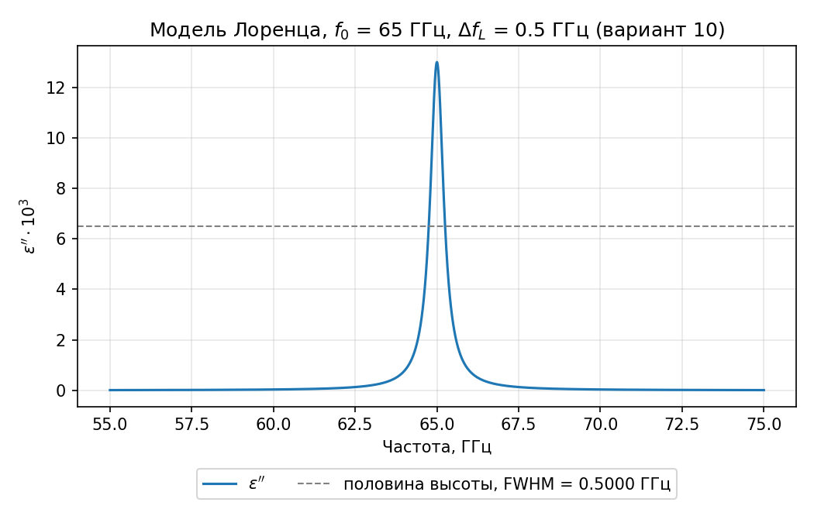
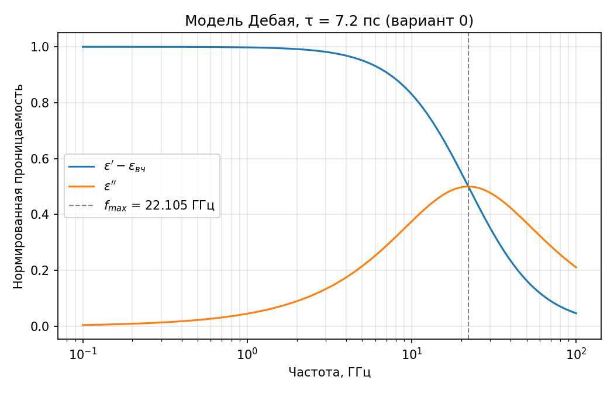
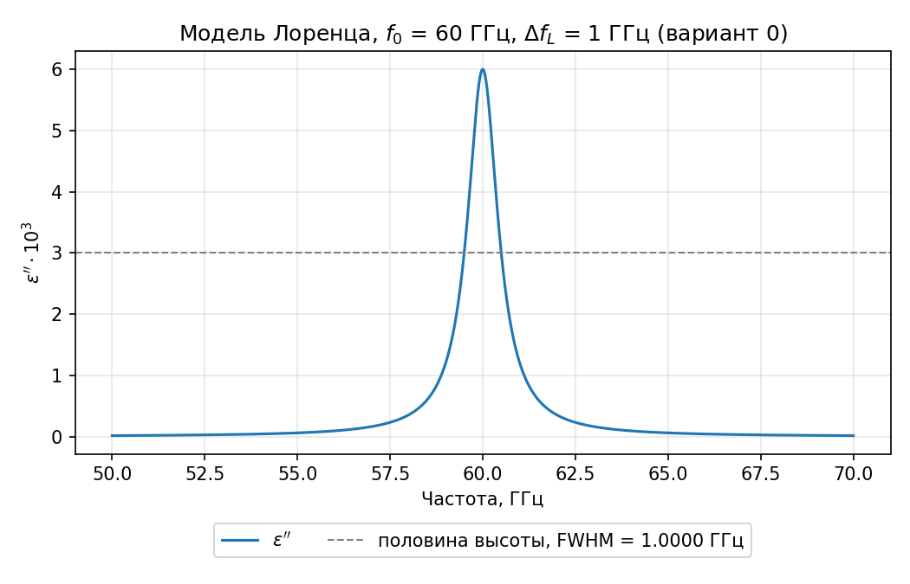
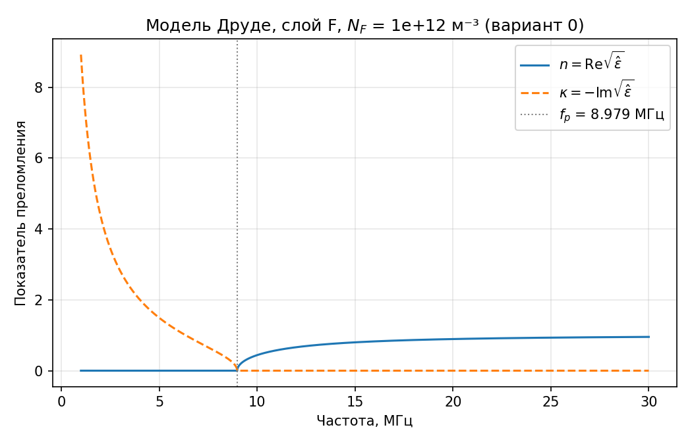

# Расчёт ДЗ-1 «Три модели диэлектрической проницаемости»: Дебай, Лоренц, Друде и ионосфера

Выполнил: **Ягафаров Азат Рамилевич**, группа **М12-512С**, вариант **10**.
Задание: ДЗ-1 к книге «Ослабление радиоволн в атмосфере», глава 1 ([текст задания](https://github.com/WarGleb/radiowave-atmosphere_hw/blob/main/dz1_dielectric_models.md)).

## Главный результат

Три модели описывают три разных механизма отклика среды на радиоволну.

- **Дебай** - релаксация полярных молекул (вода). Пик потерь широкий, на частоте $f = 1/(2\pi\tau)$ = 22,7 ГГц при τ = 7 пс.
- **Лоренц** - резонанс с возвращающей силой (линии кислорода). Пик узкий, его ширина равна частоте соударений $\nu/2\pi$ = 0,5 ГГц.
- **Друде** - свободные электроны ионосферы. Ниже плазменной частоты ($f_p$ = 8,52 МГц для слоя F) $\varepsilon' < 0$, и волна **отражается**, а не поглощается. «Затухание» 1451 дБ/км на 3 МГц - это реактивное спадание поля без потерь энергии. В слое D днём соударения ($\nu > \omega$) дают **настоящее поглощение** 1,66 дБ/км на 1 МГц, а на 30 МГц оно в 257 раз меньше.

Сверка с реальной атмосферой (книга Davies «Ionospheric Radio», модель ионосферы IRI-2020 для Москвы, рекомендации МСЭ-Р P.676-13 и P.835-7):
- $N_F$ и $N_D$ варианта - типичные **дневные** значения.
- Заданные $\nu_D$ и $\nu_F$ соответствуют слою D на ~70 км и дневному пику F2.
- Реальная линия кислорода у 65 ГГц у земли в ~4 раза шире заданной (2,1 ГГц против 0,5 ГГц), а на 20 км в ~3,5 раза уже.



## Постановка

| Величина | Вариант 0 (контроль) | Вариант 10 |
|---|---|---|
| Время релаксации τ, пс | 7,2 | 7 |
| Центр линии $f_0$, ГГц | 60 | 65 |
| Ширина линии $\Delta f_L$, ГГц | 1 | 0,5 |
| Сила линии $\Delta\varepsilon$ | $10^{-4}$ | $10^{-4}$ |
| $N_F$, м⁻³ / $\nu_F$, с⁻¹ | $10^{12}$ / $10^{3}$ | $9\cdot10^{11}$ / $10^{3}$ |
| $N_D$, м⁻³ / $\nu_D$, с⁻¹ | $10^{9}$ / $10^{7}$ | $5\cdot10^{8}$ / $10^{7}$ |
| Пробные частоты, МГц | 1; 3; 5; 10; 30 | те же |

Соглашение: поле $\propto e^{j\omega t}$, $\hat\varepsilon = \varepsilon' - j\varepsilon''$, потери дают $\varepsilon'' > 0$.

## Метод

Константы: CODATA 2022 [S1]. Код: [src/solution.py](src/solution.py) (пп. 1–4б), [src/ionosphere.py](src/ionosphere.py) (пп. 4а, 4в).

### 1. Дебай

Нормированная форма при $\varepsilon_{ст} - \varepsilon_{вч} = 1$:

$$\varepsilon' - \varepsilon_{вч} = \frac{1}{1 + (\omega\tau)^2},\qquad \varepsilon'' = \frac{\omega\tau}{1 + (\omega\tau)^2}.$$

Максимум $\varepsilon''$ находится из $d\varepsilon''/d\omega = 0$: $\omega\tau = 1$, то есть $f_{max} = 1/(2\pi\tau)$ (1.8), и $\varepsilon''_{max} = 1/2$. Численно максимум ищется на сетке 0,1–100 ГГц с шагом 1 МГц.

### 2. Лоренц: вывод

Уравнение движения связанного электрона (1.10) с затуханием $\nu$:

$$m\ddot x + m\nu\dot x + m\omega_0^2 x = -eE.$$

Для $E, x \propto e^{j\omega t}$ производная равна умножению на $j\omega$:

$$x = \frac{-eE/m}{\omega_0^2 - \omega^2 + j\omega\nu}.$$

Поляризация $P = -Nex$, $\hat\varepsilon = 1 + P/(\varepsilon_0 E)$:

$$\hat\varepsilon = 1 + \frac{\omega_p^2}{\omega_0^2 - \omega^2 + j\omega\nu},\qquad \omega_p^2 = \frac{Ne^2}{\varepsilon_0 m}.$$

При $\omega \to 0$ вклад линии равен $\omega_p^2/\omega_0^2$. Это и есть сила линии $\Delta\varepsilon$, поэтому $\hat\varepsilon = 1 + \Delta\varepsilon\,\omega_0^2/(\omega_0^2 - \omega^2 + j\omega\nu)$. Умножив на сопряжённый знаменатель:

$$\varepsilon'' = -\mathrm{Im}\,\hat\varepsilon = \frac{\Delta\varepsilon\,\omega_0^2\,\omega\nu}{(\omega_0^2-\omega^2)^2 + \omega^2\nu^2} > 0.$$

**Знак проверен:** все величины в числителе положительны, и численный минимум $\varepsilon''$ на сетке положителен (`lor_eps2_min`). Около резонанса $\omega_0^2 - \omega^2 \approx 2\omega_0(\omega_0 - \omega)$, и линия становится лоренцевой с полушириной $\nu/2$ по $\omega$. Значит, FWHM $= \nu/2\pi = \Delta f_L$, а высота пика $\approx \Delta\varepsilon\,\omega_0/\nu = \Delta\varepsilon f_0/\Delta f_L$. Сетка $f_0 \pm 10$ ГГц, шаг 0,1 МГц, FWHM ищется с линейной интерполяцией краёв.

### 3. Друде: вывод

У свободного электрона нет возвращающей силы. Уравнение (1.12) - это (1.10) с $\omega_0 = 0$:

$$m\ddot x + m\nu\dot x = -eE\ \Rightarrow\ \hat\varepsilon = 1 - \frac{\omega_p^2}{\omega(\omega - j\nu)} = \underbrace{1 - \frac{\omega_p^2}{\omega^2+\nu^2}}_{\varepsilon'} - j\,\underbrace{\frac{\omega_p^2\,\nu}{\omega(\omega^2+\nu^2)}}_{\varepsilon''>0}.$$

Дальше считаются следующие величины:
- плазменная частота $f_p = \omega_p/2\pi$;
- $\tan\delta = \varepsilon''/|\varepsilon'|$ (1.3);
- $\sqrt{\hat\varepsilon} = n - j\kappa$ (главная ветвь, $\kappa > 0$);
- затухание поля $8{,}686\cdot(\omega/c)\cdot\kappa\cdot10^3$ дБ/км.

Режим определяется так: поглощение при $\omega < \nu$, иначе отражение при $\varepsilon' < 0$, иначе прозрачность.

### 4. Сверка с источниками

- **(а) Концентрации электронов:** типичные значения днём и ночью по книге Davies «Ionospheric Radio» [S6]; дополнительная проверка - профили модели IRI-2020 для Москвы [S7].
- **(б) Линии кислорода:** P.676-13, Приложение 1, табл. 1 и ф. (4), (6a), (6b) [S3]. Атмосфера по P.835-7 [S4]: у земли 1013,25 гПа, 288,15 К, ρ = 7,5 г/м³; на 20 км 55,29 гПа, 216,65 К, без пара. В P.676 $\Delta f$ - полуширина, поэтому FWHM $= 2\Delta f$.
- **(в) Частоты соударений:** эмпирические формулы Schunk & Nagy [S8]:

  $$\nu_{en} = 2{,}33\cdot10^{-11}\, n_{N_2}\left(1 - 1{,}21\cdot10^{-4}T_e\right)T_e + 1{,}82\cdot10^{-10}\, n_{O_2}\left(1 + 3{,}6\cdot10^{-2}T_e^{1/2}\right)T_e^{1/2} \quad \text{(с нейтралами)},$$

  $$\nu_{ei} = 54{,}5\,\frac{n_i}{T_e^{3/2}} \quad \text{(с ионами)},$$

  где $n$ в см⁻³, $T_e$ в К.

  В слое D давление, температура и концентрация нейтралов $n = p/(kT)$ берутся по P.835-7 [S4], доли N₂ и O₂ - по U.S. Standard Atmosphere 1976 [S9]. Температура электронов в слое D равна температуре газа (тепловое равновесие). В слое F $N_e$ и $T_e$ берутся из файлов IRI [S7].

## Результаты

### Дебай и Лоренц

| Величина | Вариант 0 | Ответ из задания | **Вариант 10** |
|---|---|---|---|
| $f_{max}$ Дебая численно / по (1.8), ГГц | 22,105 / 22,105 | 22,105 / 22,105 | **22,736 / 22,736** |
| $\varepsilon''_{max}$ (Дебай) | 0,500 | 0,500 | **0,500** |
| Лоренц: частота максимума, ГГц | 59,998 | 59,998 | **64,9995** |
| Лоренц: высота максимума / оценка $\Delta\varepsilon f_0/\Delta f_L$ | $6{,}000\cdot10^{-3}$ / $6{,}000\cdot10^{-3}$ | $6{,}00\cdot10^{-3}$ | **1,300·10⁻² / 1,300·10⁻²** |
| Лоренц: FWHM / $\Delta f_L$, ГГц | 1,000 / 1 | 1,000 | **0,500 / 0,5** |
| $f_p$ слоя F / слоя D, МГц | 8,979 / 0,284 | 8,979 / 0,284 | **8,518 / 0,201** |

Пик Лоренца сдвинут ниже $f_0$: на 2,1 МГц в варианте 0 и на 0,5 МГц в варианте 10. Кривая $\varepsilon''(\omega)$ не строго симметрична относительно $\omega_0$, и разложение около резонанса даёт сдвиг $\approx \nu^2/(8\omega_0)$, то есть $\Delta f_L^2/(8 f_0)$ = 2,08 и 0,48 МГц - как и в численном расчёте. Сдвиг растёт как квадрат ширины линии.

### Друде, вариант 10

| Слой, частота | ε′ | ε″ | tan δ | n | κ | Затухание, дБ/км | Режим |
|---|---|---|---|---|---|---|---|
| F, 1 МГц | −71,55 | 0,01155 | 1,61·10⁻⁴ | 6,83·10⁻⁴ | 8,459 | 1540 | отражение |
| F, 3 МГц | −7,062 | 4,28·10⁻⁴ | 6,06·10⁻⁵ | 8,05·10⁻⁵ | 2,657 | 1451 | отражение |
| F, 5 МГц | −1,902 | 9,24·10⁻⁵ | 4,86·10⁻⁵ | 3,35·10⁻⁵ | 1,379 | 1255 | отражение |
| F, 10 МГц | 0,2745 | 1,16·10⁻⁵ | 4,21·10⁻⁵ | 0,5239 | 1,10·10⁻⁵ | 0,02006 | прозрачность |
| F, 30 МГц | 0,9194 | 4,28·10⁻⁷ | 4,65·10⁻⁷ | 0,9588 | 2,23·10⁻⁷ | 0,00122 | прозрачность |
| D, 1 МГц | 0,9886 | 0,01816 | 0,01837 | 0,9943 | 9,13·10⁻³ | 1,662 | поглощение |
| D, 3 МГц | 0,9965 | 1,85·10⁻³ | 1,86·10⁻³ | 0,9983 | 9,29·10⁻⁴ | 0,5072 | прозрачность |
| D, 5 МГц | 0,9985 | 4,66·10⁻⁴ | 4,67·10⁻⁴ | 0,9993 | 2,33·10⁻⁴ | 0,2122 | прозрачность |
| D, 10 МГц | 0,9996 | 6,26·10⁻⁵ | 6,26·10⁻⁵ | 0,9998 | 3,13·10⁻⁵ | 0,05696 | прозрачность |
| D, 30 МГц | 0,999955 | 2,37·10⁻⁶ | 2,37·10⁻⁶ | 0,999978 | 1,18·10⁻⁶ | 0,00647 | прозрачность |

Полная таблица: [results/dz1_variant10.csv](results/dz1_variant10.csv).

### Друде, вариант 0 (контроль)

| Слой, частота | ε′ | ε″ | tan δ | n | κ | Затухание, дБ/км | Режим |
|---|---|---|---|---|---|---|---|
| F, 1 МГц | −79,62 | 0,01283 | 1,61·10⁻⁴ | 7,19·10⁻⁴ | 8,923 | 1624 | отражение |
| F, 3 МГц | −7,957 | 4,75·10⁻⁴ | 5,97·10⁻⁵ | 8,42·10⁻⁵ | 2,821 | 1541 | отражение |
| F, 5 МГц | −2,225 | 1,03·10⁻⁴ | 4,61·10⁻⁵ | 3,44·10⁻⁵ | 1,492 | 1358 | отражение |
| F, 10 МГц | 0,1938 | 1,28·10⁻⁵ | 6,62·10⁻⁵ | 0,4403 | 1,46·10⁻⁵ | 0,02653 | прозрачность |
| F, 30 МГц | 0,9104 | 4,75·10⁻⁷ | 5,22·10⁻⁷ | 0,9542 | 2,49·10⁻⁷ | 0,00136 | прозрачность |
| D, 1 МГц | 0,9772 | 0,03632 | 0,03716 | 0,9887 | 0,01837 | 3,343 | поглощение |
| D, 3 МГц | 0,9930 | 3,71·10⁻³ | 3,73·10⁻³ | 0,9965 | 1,86·10⁻³ | 1,016 | прозрачность |
| D, 5 МГц | 0,9971 | 9,32·10⁻⁴ | 9,35·10⁻⁴ | 0,9985 | 4,67·10⁻⁴ | 0,4248 | прозрачность |
| D, 10 МГц | 0,9992 | 1,25·10⁻⁴ | 1,25·10⁻⁴ | 0,9996 | 6,26·10⁻⁵ | 0,1139 | прозрачность |
| D, 30 МГц | 0,99991 | 4,74·10⁻⁶ | 4,74·10⁻⁶ | 0,99996 | 2,37·10⁻⁶ | 0,01294 | прозрачность |

Контрольный вариант совпадает с ответами из задания: **да**, все 19 величин в пределах допуска (`pytest`: 19 passed).

### П. 4. Сверка с источниками

**(а) Концентрации электронов.** Типичные значения для средних широт взяты из книги Davies [S6]: § 5.1.1, рис. 5.1, § 5.4. Для проверки те же величины посчитаны моделью IRI-2020 [S7] на сайте NASA CCMC для Москвы (55,75° с. ш., 37,62° в. д.) в полдень и в полночь по местному времени. В варианте место не задано: Москва взята как типичное место средних широт, для которых даны значения у Davies. Дата 15.03.2025 - около весеннего равноденствия, когда день и ночь равны и профили не искажены сезоном; для неё в модели есть измеренные индексы солнечной активности. Выходные файлы IRI и скриншоты с сайта лежат в [data/](data/).

| Слой | Высота | Днём: Davies [S6] | Днём: IRI, Москва [S7] | Ночью: Davies [S6] | Ночью: IRI, Москва [S7] |
|---|---|---|---|---|---|
| D | 80 км | ~10⁹ | 7,9·10⁸ | < 10⁸ | 1·10⁶ |
| E (пик) | ~110 км | - | 1,3·10¹¹ | ~10⁹ | 3,5·10⁹ |
| **F2 (пик)** | 250–400 км | **~10¹²** | **1,19·10¹²** (256 км) | **~(2–3)·10¹¹** | **2,46·10¹¹** (343 км) |

Все значения в м⁻³. По IRI также: на 70 км днём 3,3·10⁸, ночью ниже 80 км значений нет; TEC днём 4,25·10¹⁷, ночью 9,9·10¹⁶ эл/м².



График построен по сохранённым выходным файлам IRI (`python dz1/src/ionosphere.py`). Логарифмическая шкала показывает и слой D, и пик F2; на скриншотах с сайта ([день](data/iri2020_moscow_2025-03-15_09UT_Ne.png), [ночь](data/iri2020_moscow_2025-03-15_21UT_Ne.png)) шкала линейная, и слой D сливается с нулём.

Выводы:
- Книга и модель согласуются: дневной и ночной пики F2 над Москвой практически равны типичным значениям Davies, слой D на 80 км днём ~10⁹, ночью много меньше 10⁸ м⁻³.
- **Вариант 10:**
  - $N_F = 9\cdot10^{11}$ м⁻³ - порядок дневного пика F по Davies (~10¹²) и 0,76 от дневного пика над Москвой по IRI; ночного (~2–3·10¹¹) больше в 3–4 раза. Значит, это **типичный дневной** слой F; $f_p$ = 8,5 МГц против 9,8 МГц у дневного пика IRI.
  - $N_D = 5\cdot10^{8}$ м⁻³ - ниже дневных ~10⁹ на 80 км (Davies) и соответствует дневному слою D на ~75 км по IRI. Ночью на этой высоте электронов почти нет. Это тоже **дневное** значение.
- Вариант 0: $N_F = 10^{12}$ практически совпадает с дневным пиком F2, $N_D = 10^{9}$ - дневной слой D на ~80–85 км.
- Ночью F2 слабеет примерно в 5 раз и поднимается выше, но остаётся. $f_p$ падает с ~9,8 до ~4,5 МГц, поэтому ночью ионосфера отражает только более низкие частоты.
- Слой D ночью практически исчезает: по Davies на 80 км концентрация падает с ~10⁹ до < 10⁸ м⁻³, по IRI - в ~800 раз. Поэтому ночью нет поглощения в слое D, и средние волны уходят далеко (вопрос 3).
- TEC по IRI днём и ночью попадает в диапазон 10¹⁶–10¹⁸ эл/м² из P.531-16 [S2].
- Расчёт IRI сделан при высокой солнечной активности (Rz12 = 95, F10.7 = 176, около максимума 25-го цикла). В минимуме цикла $N_F$ было бы заметно меньше.
- То же видно на профиле из Лекции 1, слайд 6 [S5]: днём слой D на 2–3 порядка слабее максимума F.

**(б) Линии кислорода (P.676-13, табл. 1).** Три ближайшие к $f_0$ линии:

| Вариант | Линия, ГГц | FWHM у земли, ГГц | FWHM на 20 км, ГГц | Реальная ширина у земли / $\Delta f_L$ |
|---|---|---|---|---|
| **10** ($f_0$ = 65, $\Delta f_L$ = 0,5) | 64,679 | 2,18 | 0,149 | 4,35 |
| | 65,224 | 2,09 | 0,143 | 4,17 |
| | 65,765 | 2,00 | 0,137 | 4,00 |
| 0 ($f_0$ = 60, $\Delta f_L$ = 1) | 59,591 | 2,95 | 0,202 | 2,95 |
| | 60,306 | 2,96 | 0,203 | 2,96 |
| | 60,435 | 2,81 | 0,192 | 2,81 |

- **Вариант 10:** ровно на 65 ГГц линии нет. Ближайшая - 65,224 ГГц, на 0,22 ГГц выше; $f_0$ лежит между линиями 64,679 и 65,224 ГГц. Заданная ширина 0,5 ГГц примерно в **4 раза уже** реальной у земли (~2,1 ГГц) и в **3,5 раза шире**, чем на 20 км (~0,14 ГГц).
- 65 ГГц - край кислородной полосы 50–70 ГГц. Интенсивность линии 65,224 ГГц ($a_1$ = 274) примерно в 8 раз меньше, чем у линий около 60 ГГц ($a_1$ ≈ 2100), а коэффициент ширины $a_3$ меньше (9,96 против ~14). Поэтому линии у 65 ГГц и слабее, и уже.
- Вариант 0: ровно на 60 ГГц линии тоже нет, заданная ширина 1 ГГц примерно в 3 раза уже реальной у земли и в 5 раз шире, чем на 20 км.
- То же показывает спектр O₂ 58–60,5 ГГц в Лекции 1 (слайды 6–7) [S5]: на высоте линии разделены, а с ростом высоты столкновительное уширение уступает доплеровскому.
- **Почему на 20 км ширина другая.** Ширина определяется **соударениями молекул** (столкновительное уширение): $\Delta f \propto p\,\theta^{0{,}8}$, $\theta = 300/T$. На 20 км давление в 18 раз меньше, поэтому линии в ~15 раз уже. Множитель $\theta^{0{,}8}$ частично компенсирует падение давления: на высоте холоднее.
- У земли ширины (~2–3 ГГц) больше расстояния между соседними линиями (~0,1–0,7 ГГц). Линии сливаются в сплошную полосу поглощения. На высоте они разделяются.
- На 20 км ширина (~150–200 МГц) ещё намного больше доплеровской (~0,1 МГц) и зеемановской (~1,5 МГц, поправка в (6b)). Они начинают задавать ширину только выше ~50–60 км.

**(в) Частоты соударений.** В задании $\nu_D = 10^7$ и $\nu_F = 10^3$ с⁻¹ даны. Здесь они проверены независимым расчётом ([results/collision_check.csv](results/collision_check.csv)). В слое D считаются соударения с нейтралами по стандартной атмосфере P.835, в слое F - соударения с ионами по профилям IRI над Москвой.

| Слой | Высота | Концентрация, см⁻³ | $T$, К | $\nu$ по Schunk & Nagy [S8], с⁻¹ | $\nu$ по Davies (1.62a) [S6], с⁻¹ |
|---|---|---|---|---|---|
| D | 60 км | нейтралы 6,4·10¹⁵ | 247 (P.835) | 3,4·10⁷ | 5,1·10⁷ |
| D | 70 км | нейтралы 1,7·10¹⁵ | 220 (P.835) | 8,2·10⁶ | 1,3·10⁷ |
| D | 80 км | нейтралы 3,8·10¹⁴ | 199 (P.835) | 1,7·10⁶ | 2,7·10⁶ |
| D | 90 км | нейтралы 7,3·10¹³ | 179 (P.835) | 2,9·10⁵ | 4,9·10⁵ |
| F2 (пик), день | 260 км | электроны 1,19·10⁶ | 1805 (IRI) | 850 (с ионами) | - |
| F2 (пик), ночь | 350 км | электроны 2,45·10⁵ | 1389 (IRI) | 260 (с ионами) | - |

- Две независимые эмпирические формулы - подробная Schunk & Nagy и упрощённая Davies (1.62a) - расходятся в 1,5–1,7 раза. Для оценок такого рода это хорошее согласие.
- Порядки согласуются и с текстом Davies [S6]: в слое D частота соударений порядка 10⁶ с⁻¹ (§ 5.4), по рис. 7.5 ~10⁶–10⁷ с⁻¹ в слое D и ~10²–10⁴ с⁻¹ на высотах слоя F.
- $\nu_D = 10^7$ с⁻¹ соответствует высоте **~70 км** (по Davies ~72 км). В слое D частота соударений падает с высотой вместе с плотностью воздуха, в 4–6 раз на каждые 10 км.
- В варианте 10 $N_D = 5\cdot10^8$ м⁻³ соответствует высоте ~75 км, где по расчёту $\nu \approx 4\cdot10^6$ с⁻¹. Это тот же порядок, что $10^7$. Задание описывает нижнюю часть дневного слоя D, где поглощение сильнее всего.
- На 80 км $\nu \approx 1{,}7\cdot10^6$ с⁻¹ < ω на 1 МГц (6,3·10⁶ с⁻¹). Если брать слой D повыше, условие «поглощения» из раздела 1.5 ($\omega < \nu$) на 1 МГц уже не выполняется. Классификация режима чувствительна к выбору высоты.
- $\nu_F = 10^3$ с⁻¹ соответствует **дневному пику F2** (850 с⁻¹). Ночью из-за меньшего $N_e$ частота ~260 с⁻¹. В слое F главный вклад дают соударения с ионами; соударения с нейтралами здесь не считались (нужна плотность атомарного кислорода из модели атмосферы NRLMSIS).

### Графики

| | Дебай | Лоренц | Друде, слой F |
|---|---|---|---|
| **Вариант 10** |  |  |  |
| Вариант 0 |  |  |  |

## Ответы на вопросы для защиты

Ответы на все 5 вопросов - в отдельном файле [ANSWERS.md](ANSWERS.md).

## Как запустить

```
pip install -r requirements.txt
python dz1/src/solution.py --dz dz1 --variant 0 --save
python dz1/src/solution.py --dz dz1 --variant 10 --save
python dz1/src/ionosphere.py
pytest
```

Команды выполняются из корня репозитория. Таблицы результатов и графики сохраняются в `dz1/results/`, исходные данные модели IRI лежат в `dz1/data/`.

## Источники

См. [SOURCES.md](SOURCES.md). Список литературы по ГОСТ Р 7.0.5-2008 (номера [S1]–[S9] совпадают с SOURCES.md):

1. [S1] Fundamental Physical Constants. CODATA Recommended Values 2022 [Электронный ресурс] / National Institute of Standards and Technology. URL: https://physics.nist.gov/cuu/Constants/ (дата обращения: 28.10.2026).
2. [S2] Рекомендация МСЭ-R P.531-16 (09/2025). Данные об ионосферном распространении радиоволн и методы прогнозирования, необходимые для проектирования спутниковых сетей и систем. Женева : МСЭ, 2025. 25 с. URL: https://www.itu.int/rec/R-REC-P.531/en (дата обращения: 28.10.2026).
3. [S3] Рекомендация МСЭ-R P.676-13 (08/2022). Затухание в атмосферных газах и связанное с ним воздействие. Женева : МСЭ, 2022. 31 с. URL: https://www.itu.int/rec/R-REC-P.676/en (дата обращения: 28.10.2026).
4. [S4] Рекомендация МСЭ-R P.835-7 (08/2024). Эталонные атмосферы. Женева : МСЭ, 2024. 11 с. URL: https://www.itu.int/rec/R-REC-P.835/en (дата обращения: 28.10.2026).
5. [S5] Особенности распространения радиоволн в околоземном и космическом пространствах : лекция № 1 по дисциплине «Электродинамика и распространение радиоволн» : материалы курса.
6. [S6] Davies K. Ionospheric Radio. London : Peter Peregrinus, 1990 ; reprint London : The Institution of Engineering and Technology, 2008. (IEE Electromagnetic Waves Series ; 31). ISBN 978-0-86341-186-1.
7. [S7] Bilitza D., Pezzopane M., Truhlik V., Altadill D., Reinisch B. W., Pignalberi A. The International Reference Ionosphere model: a review and description of an ionospheric benchmark // Reviews of Geophysics. 2022. Vol. 60. Art. e2022RG000792. DOI: 10.1029/2022RG000792.
8. [S7] International Reference Ionosphere IRI-2020 : Instant Run [Электронный ресурс] / NASA Community Coordinated Modeling Center. URL: https://ccmc.gsfc.nasa.gov/instantrun/iri/ (дата обращения: 28.10.2026).
9. [S8] Schunk R. W., Nagy A. F. Ionospheres: Physics, Plasma Physics, and Chemistry. Cambridge : Cambridge University Press, 2000. (Cambridge Atmospheric and Space Science Series). ISBN 0-521-63237-4.
10. [S9] U.S. Standard Atmosphere, 1976 / NOAA, NASA, USAF. Washington : U.S. Government Printing Office, 1976. (NOAA-S/T 76-1562 ; NASA-TM-X-74335). URL: https://ntrs.nasa.gov/citations/19770009539 (дата обращения: 28.10.2026).

## Использование ИИ

ИИ-помощник использовался для:
- структуры программы и кода расчёта;
- пояснения вывода формул Лоренца и Друде;
- поиска рекомендаций МСЭ-Р и других источников;
- черновика README и SOURCES.

Вручную мной:
- нашел книги Davies «Ionospheric Radio» и Schunk & Nagy «Ionospheres», по которым проверены концентрации электронов и формулы частот соударений;
- все источники S1–S9 в SOURCES.md открыты мной лично: значения констант на сайте NIST; версии рекомендаций P.531, P.676, P.835 на itu.int, формулы и строки таблиц в их PDF на русском; страницы книг Davies и Schunk & Nagy, U.S. Standard Atmosphere 1976 и Лекции 1;
- расчёт модели IRI-2020 запущен мной на сайте NASA CCMC, выходные файлы сохранены в `data/`;
- совпадение контрольного варианта 0 с ответами из задания.

## Ограничения и что бы я улучшил

- Модель Друде не учитывает магнитное поле Земли. При гирочастоте ~1,4 МГц ионосфера анизотропна (обыкновенная и необыкновенная волны), и на 1–3 МГц это существенно.
- Слои считаются однородными. На деле $N_e(h)$ и $\nu(h)$ меняются с высотой (п. 4а, 4в), и отражение происходит на высоте, где $f = f_p(h)$.
- Модель Лоренца - одна изолированная линия. Реальный спектр у 60–65 ГГц - десятки перекрывающихся линий с интерференционной поправкой δ (P.676, ф. (7)).
- Дебай взят с одним временем релаксации. Для воды нужна двойная модель (ДЗ-2).
- Сверка с IRI сделана для одной даты при высокой солнечной активности. Для полноты нужно сравнить минимум и максимум солнечного цикла, лето и зиму.
- Частоты соударений в слое F посчитаны только с ионами; для полной оценки нужен вклад нейтралов по модели NRLMSIS.

## Лицензия

Код: MIT ([LICENSE](../LICENSE)). Текст и рисунки: CC BY 4.0. Данные из рекомендаций МСЭ-Р используются только как ссылки на значения.
